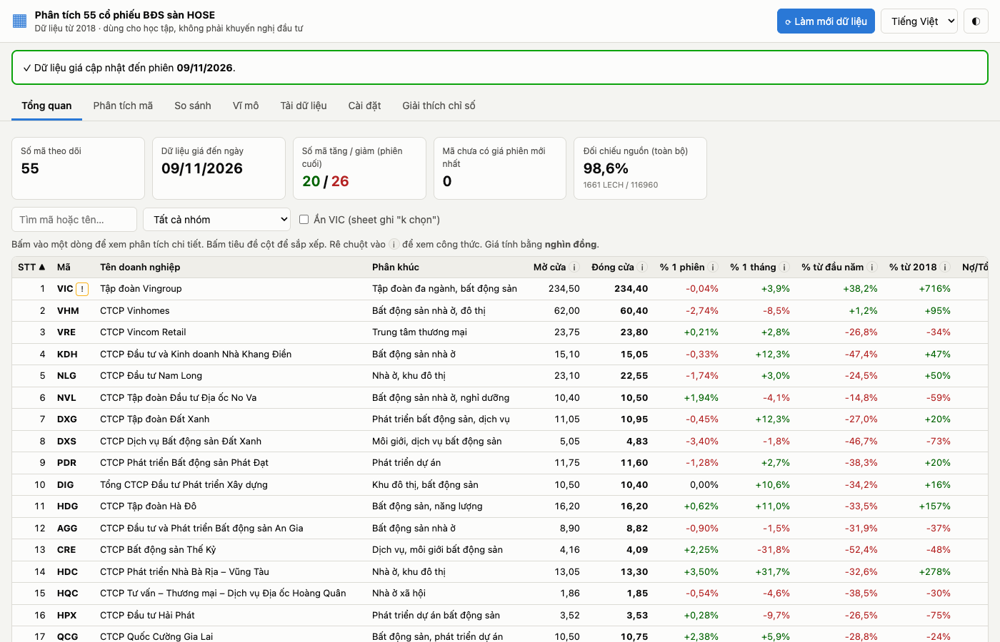
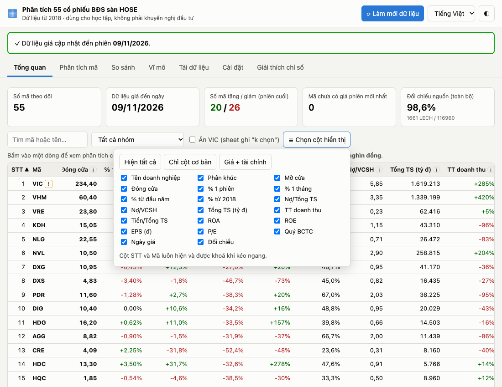
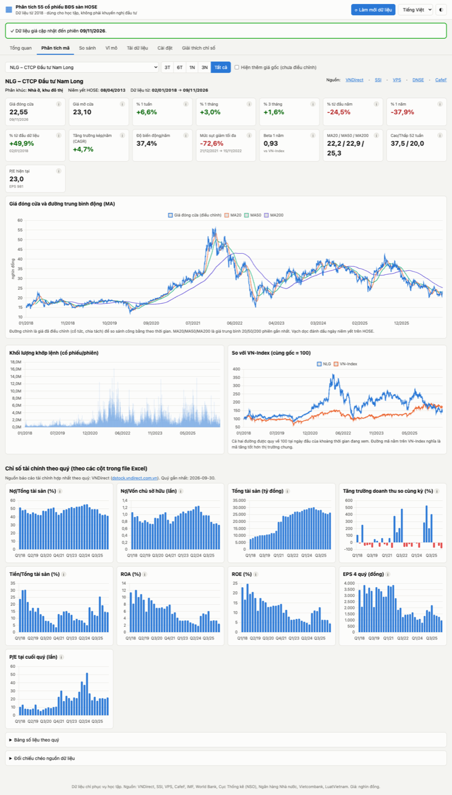
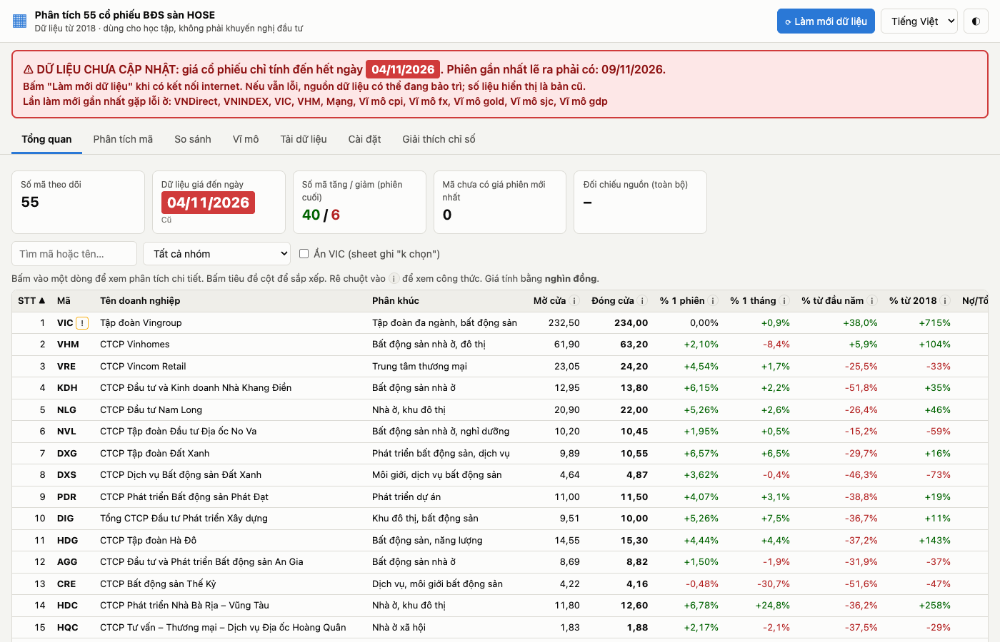

# Phân tích 55 cổ phiếu Bất động sản sàn HOSE

Ứng dụng giúp học sinh, sinh viên xem và phân tích giá cổ phiếu của 55 doanh nghiệp bất động sản niêm yết trên sàn HOSE, từ năm 2018 đến nay, cùng các chỉ số kinh tế vĩ mô của Việt Nam.

**Không cần cài đặt gì. Không cần biết lập trình.** Chạy được trên Windows và macOS.

---

## 1. Tải về

1. Bấm vào link này để tải: **[⬇ Tải ứng dụng (BDS-HOSE-App.zip)](https://github.com/tunt01102/stock-data/releases/latest/download/BDS-HOSE-App.zip)**
   - File khoảng 90 MB, chứa sẵn mọi thứ cần thiết và dữ liệu từ 2018.
   - Nếu link không chạy: mở trang **[Releases](https://github.com/tunt01102/stock-data/releases)**, bấm vào file `BDS-HOSE-App.zip` ở bản mới nhất.
2. Tìm file vừa tải (thường ở thư mục **Downloads / Tải xuống**).
3. **Giải nén** file:
   - **Windows:** bấm chuột phải vào file → chọn **Extract All… (Giải nén tất cả)** → bấm **Extract**.
   - **macOS:** bấm đúp vào file, máy tự giải nén.
4. Bạn sẽ có thư mục **BDS-HOSE-App**. Có thể chuyển thư mục này đi đâu tuỳ ý (ví dụ ra Desktop).

> ⚠ Phải giải nén trước. Đừng mở ứng dụng ngay bên trong file .zip.

## 2. Mở ứng dụng

### Trên Windows
1. Mở thư mục **BDS-HOSE-App**.
2. Bấm đúp vào file **`Mo ung dung (Windows).bat`**.
3. Nếu hiện bảng xanh **"Windows protected your PC"**: bấm **More info** → bấm **Run anyway**. (Chỉ lần đầu.)
4. Một cửa sổ màu đen hiện ra, và trình duyệt tự mở trang ứng dụng.

### Trên macOS
1. Mở thư mục **BDS-HOSE-App**.
2. **Lần đầu:** bấm **chuột phải** (hoặc giữ phím Control rồi bấm) vào file **`Mo ung dung (Mac).command`** → chọn **Open** → bấm **Open** lần nữa.
   - Nếu máy vẫn chặn: vào **System Settings → Privacy & Security**, kéo xuống dưới, bấm **Open Anyway**, rồi làm lại bước 2.
3. Từ lần sau chỉ cần bấm đúp vào file đó.
4. Một cửa sổ Terminal hiện ra, và trình duyệt tự mở trang ứng dụng.

### Lưu ý khi dùng
- **Giữ cửa sổ đen (Windows) / Terminal (Mac) mở** trong lúc dùng. Đóng cửa sổ đó là tắt ứng dụng.
- Nếu trình duyệt không tự mở: mở Chrome/Edge/Safari và gõ địa chỉ in trong cửa sổ đen, thường là **http://127.0.0.1:8686**.
- Ứng dụng chỉ chạy trên máy của bạn, người khác không truy cập được.

## 3. Các phần của ứng dụng

| Tab | Dùng để |
|---|---|
| **Tổng quan** | Bảng 55 mã: giá mở/đóng cửa, % tăng giảm, các chỉ số tài chính. Bấm tiêu đề cột để sắp xếp. Bấm vào một dòng để xem chi tiết mã đó. |
| **Phân tích mã** | Biểu đồ giá từ 2018, đường trung bình động, so với VN-Index, và 9 biểu đồ chỉ số tài chính theo quý. |
| **So sánh** | Chọn tối đa 8 mã để so sánh mức tăng/giảm trên cùng một biểu đồ. |
| **Vĩ mô** | Lạm phát, lãi suất Ngân hàng Nhà nước, VN-Index, GDP, tỷ giá, giá vàng, các luật/nghị định về bất động sản. |
| **Tải dữ liệu** | Tải file CSV (mở bằng Excel) cho 1 mã, một nhóm, hoặc tất cả. |
| **Cài đặt** | Đổi ngôn ngữ, nhập API key AI (không bắt buộc). |
| **Giải thích chỉ số** | Công thức và ý nghĩa của từng chỉ số, viết dễ hiểu. |

Mẹo:
- Rê chuột vào biểu tượng **ⓘ** để xem công thức của chỉ số.
- Đổi tiếng Việt/English bằng ô chọn ở góc trên bên phải; nút **◐** đổi nền sáng/tối.
- Bảng Tổng quan có nhiều cột. Khi kéo ngang, cột **STT** và **Mã** luôn đứng yên. Bấm **☰ Chọn cột hiển thị** để ẩn bớt cột (ví dụ chọn "Chỉ cột cơ bản").

## 4. Cập nhật dữ liệu mới

- Mỗi lần mở ứng dụng (khi có internet), các ngày còn thiếu **tự động** được tải thêm. Thanh tiến độ hiện ở đầu trang.
- Muốn tải ngay: bấm nút **⟳ Làm mới dữ liệu**.
- **Nếu không tải được** (mất mạng, nguồn bị lỗi), ứng dụng hiện **khung màu đỏ** ghi rõ dữ liệu chỉ tính đến ngày nào. Số liệu đang thấy là bản cũ.

## 5. Tải dữ liệu về máy (CSV)

1. Vào tab **Tải dữ liệu**.
2. Chọn **Loại dữ liệu**: giá hằng ngày, chỉ số tài chính theo quý, hoặc cả hai.
3. Bấm vào các mã cần tải (mã được chọn chuyển màu xanh), hoặc bấm **Chọn tất cả 55 mã**, hoặc bấm tên một nhóm (ví dụ "+ Khu công nghiệp").
4. Bấm **⬇ Tải các mã đã chọn**.
   - 1 mã → nhận 1 file `.csv`.
   - Nhiều mã → nhận 1 file `.zip`, gồm file riêng từng mã và một file tổng hợp.
5. Mở file `.csv` bằng **Excel** (bấm đúp). Giá tính bằng **nghìn đồng** (ví dụ 29,5 = 29.500 đồng).

Toàn bộ dữ liệu cũng nằm sẵn trong thư mục `BDS-HOSE-App/app/data`.

## 6. Dùng AI để hỏi về số liệu (không bắt buộc)

Không có AI ứng dụng vẫn chạy đầy đủ. Nếu muốn AI giải thích, tóm tắt số liệu:

1. Tạo API key ở **một** trong các trang: [Claude](https://console.anthropic.com/settings/keys), [Gemini](https://aistudio.google.com/app/apikey), [OpenAI](https://platform.openai.com/api-keys). (Có thể mất phí theo chính sách của nhà cung cấp.)
2. Vào tab **Cài đặt**, dán key vào ô tương ứng → bấm **Lưu** → bấm **Thử kết nối AI**.
3. Ở tab **Phân tích mã** hoặc **Vĩ mô** sẽ có ô **Hỏi AI**.

Key chỉ được lưu trên máy bạn và chỉ gửi tới nhà cung cấp AI bạn chọn. **Đừng chia sẻ thư mục ứng dụng cho người khác sau khi đã nhập key.**

## 7. Nguồn dữ liệu và đối chiếu

| Dữ liệu | Nguồn chính | Nguồn đối chiếu |
|---|---|---|
| Giá cổ phiếu, VN-Index | VNDirect | SSI, VPS, CafeF, DNSE |
| Báo cáo tài chính theo quý | VNDirect | – |
| Lạm phát (CPI) | **Cục Thống kê** (nso.gov.vn), thông cáo hằng tháng – đủ 106/106 tháng từ 2018 | IMF, World Bank |
| Lãi suất điều hành, liên ngân hàng | **Ngân hàng Nhà nước** (sbv.gov.vn) | bảng các quyết định điều chỉnh từ 2018 |
| Tỷ giá | **Ngân hàng Nhà nước** (tỷ giá trung tâm hằng ngày từ 2018) | IMF, World Bank, Vietcombank |
| GDP | **Cục Thống kê** (thông cáo quý) | World Bank |
| Giá vàng | **Chỉ số giá vàng của Cục Thống kê** | Giá vàng miếng SJC (qua webgia.com), giá thế giới (IMF) |
| Văn bản pháp luật | Cổng văn bản Chính phủ, Công báo, Bộ Tư pháp | LuatVietnam (bản tham khảo) |

Mỗi số liệu trong ứng dụng có link bấm được tới nguồn gốc. Nhãn **OK** nghĩa là các nguồn khớp nhau, **LECH** là có chênh lệch (bấm vào để xem chi tiết).

## 8. Gặp sự cố?

| Hiện tượng | Cách xử lý |
|---|---|
| Bấm đúp không thấy gì (Mac) | Làm lại bước "chuột phải → Open" ở mục 2. |
| Windows báo "protected your PC" | Bấm **More info** → **Run anyway**. |
| Trình duyệt không tự mở | Gõ địa chỉ in trong cửa sổ đen (vd. http://127.0.0.1:8686) vào trình duyệt. |
| Khung đỏ "Dữ liệu chưa cập nhật" | Kiểm tra internet rồi bấm **Làm mới dữ liệu**. Nếu vẫn đỏ, nguồn dữ liệu có thể đang bảo trì; thử lại sau. |
| Đóng nhầm cửa sổ đen | Mở lại file "Mo ung dung" như bước 2. |

---

## Dành cho người phát triển

- Thiết kế chi tiết: [docs/SDD.md](docs/SDD.md)
- Chạy từ mã nguồn (Python 3.8+, chỉ dùng thư viện chuẩn): `python3 app/server.py`
- Kiểm thử: `cd app && python3 -m unittest discover -s tests -v`
- Đóng gói bản không cần cài đặt: `python3 tools/build_dist.py` → `dist/BDS-HOSE-App.zip`
- GitHub Actions (`.github/workflows/test.yml`) build gói và chạy thử trên **Windows và macOS thật** mỗi lần push.
- Biến môi trường: `BDS_PORT` (mặc định 8686), `BDS_DATA_DIR`, `BDS_AUTO_REFRESH=0`, `BDS_NO_BROWSER=1`.

*Dữ liệu chỉ phục vụ học tập, không phải khuyến nghị đầu tư.*
